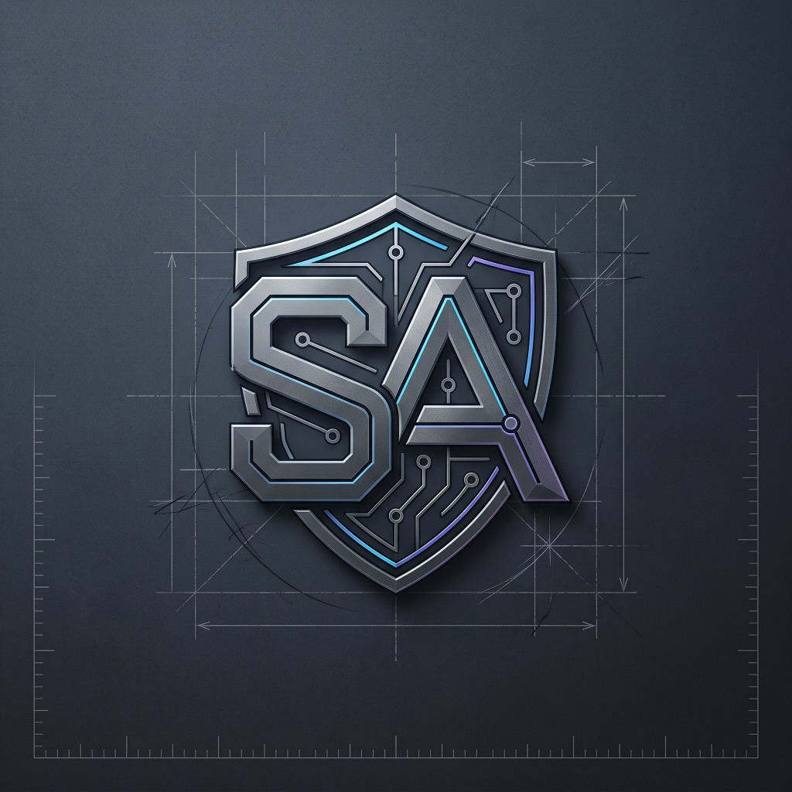

# Training IT Security Awareness and Cybersecurity Protection 2026

<p align="center">
  
</p>

<p align="center">
  <strong>Portal Pembelajaran & Simulasi Eksploratif Keamanan Siber Berbasis Klien (Zero-Backend)</strong>
</p>

<p align="center">
  Narasumber: <strong>Sigit Adi Irianto, S.Kom.</strong> (<a href="https://sigitadi.id/">sigitadi.id</a>)
</p>

<p align="center">
  
  
  
  
  
</p>

<p align="center">
  <a href="https://trainingwbk.sigitadi.id/">
    
  </a>
</p>

---

## Tentang Proyek

Aplikasi web interaktif ini dirancang untuk mendukung pelatihan peningkatan kesadaran keamanan informasi bagi staf dan profesional IT di sektor perbankan dan layanan teknologi finansial. Aplikasi bersifat **pembelajaran eksploratif tanpa ujian skor/sertifikat**, memungkinkan peserta menguji langsung berbagai skenario insiden secara visual dan mandiri.

> **Catatan Contoh Studi Kasus (Entitas Rekaan):**
> Nama **PT. Sigit Adi Aman Siber (SaaS)** dan platform Core Banking System **SaaSCore** yang digunakan di dalam modul dan skenario simulasi merupakan entitas rekaan (tidak nyata) semata-mata untuk memudahkan pemahaman serta memberikan pengalaman belajar (*user experience*) yang selaras dengan alur kerja nyata.

---

## Fitur Utama

1. **10 Modul Materi, Diagram Alur Kerja, & Analogi Sehari-hari:**
   - Pembahasan konsep keamanan siber mulai dari CIA Triad, Social Engineering, Autentikasi MFA, Enkripsi, hingga Respons Insiden, dilengkapi diagram alur kerja operasional SaaSCore (4-5 langkah per modul) dan navigasi sidebar desktop yang dapat dibuka/tutup (tersimpan di `localStorage`).
2. **10 Lab Simulasi Interaktif:**
   - Simulasi alur audit CIA Triad, visualisasi rantai serangan (*attack path*), inspeksi email phishing, penguji kekuatan *passphrase*, klasifikasi data sensitif & pratinjau masking, audit keamanan endpoint, deteksi *Evil Twin* & URL palsu, triase insiden, audit hak akses cloud & percakapan grup, serta simulasi diskusi kasus lintas modul.
3. **Balloon Tooltips Interaktif Menyeluruh:**
   - Menggantikan kamus istilah statis; mengarahkan kursor (*hover*) atau mengetuk kata teknis bergaris titik-titik menampilkan balon penjelasan praktis serta konteks operasional perbankan (termasuk `server`, `database`, `dump`, `failover`, `KMS`, ekstensi berkas berbahaya, dan puluhan istilah keamanan siber lainnya) di seluruh 10 Modul, 10 Lab, dan Sesi Penutup.
4. **Header Mengambang (Floating & Translucent) & Modal Catatan Kasus:**
   - Menggunakan efek kaca transparan (*backdrop-blur-md*) pada header atas dengan tombol buka/tutup sidebar desktop (`Alt+B` atau `[`), tombol ikon Info untuk membuka Modal Dialog Catatan Contoh Studi Kasus (Entitas Rekaan), serta bebas footer mengambang agar ruang baca tetap lega.
5. **Jam Real-time & Status Rundown:**
   - Sinkronisasi tanggal, jam berjalan, dan status sesi aktif dari 13 segmen rundown kegiatan (08.30 - 16.15) langsung di header.
6. **Mode Narasumber (Pintasan 9x Klik Logo):**
   - Mengklik logo pelatihan di pojok kiri atas header 9 kali berturut-turut membuka kendali instruktur: tombol ikon Mode Proyektor (`Monitor`, +25% font, header ramping, navigasi keyboard, dropdown lompat cepat 21 slide, dan layar penuh), Panduan Narasumber (tersembunyi otomatis saat Mode Proyektor agar catatan tidak bocor ke layar peserta), tombol solusi lab, dan tombol ikon ringkas (`LockOpen | LogOut`) untuk keluar dari Mode Narasumber. (Dropdown simulasi waktu disembunyikan via `ENABLE_TIME_SIMULATION` di `src/lib/features.ts`).
7. **Kartu Saku 7 Kebiasaan Emas:**
   - Tata letak cetak ramah kertas (*print-friendly*) untuk menyimpan kartu saku 7 Kebiasaan Emas sebagai panduan harian. (Fitur Cetak Handout A4 disembunyikan dari UI via `ENABLE_PRINT_HANDOUT` di `src/lib/features.ts`).
8. **Open Graph & Social Share Preview:**
   - Dilengkapi kartu pratinjau tautan 1200x630 (`public/og-image.jpg`) serta metadata Open Graph dan Twitter Card lengkap untuk tampilan berbagi tautan yang rapi di WhatsApp, Telegram, LinkedIn, X, dan Facebook.

---

## Struktur Folder

```text
├── public/                 # Aset publik statis (logo, favicon, og-image.jpg)
├── src/
│   ├── components/
│   │   ├── labs/           # 10 Modul Simulasi Lab
│   │   ├── ui/             # Komponen UI (TermTooltip, RichTermText, Callout, WorkflowDiagram)
│   │   ├── ClosingSummaryView.tsx
│   │   ├── Layout.tsx      # Floating header, sidebar buka/tutup, modal catatan kasus & navigasi
│   │   ├── MaterialView.tsx
│   │   ├── ModulePage.tsx
│   │   └── PrintableHandout.tsx
│   ├── data/               # Data modul, diagram alur kerja, istilah teknis, dan kebiasaan emas
│   ├── lib/                # Router hash, perhitungan rundown, dan hook eksplorasi lab
│   └── state/              # Manajemen progres lokal (LocalStorage)
├── DESIGN.md               # Arah visual, palet warna, tipografi, dan standar antislop
├── CHANGELOG.md            # Riwayat versi dan perubahan fitur
├── REVISI.md               # Catatan kepatuhan audit dan matriks revisi
└── vite.config.ts
```

---

## Menjalankan Proyek Secara Lokal

### Prasyarat
- [Node.js](https://nodejs.org/) (versi 18 ke atas disarankan)
- [pnpm](https://pnpm.io/) atau `npm`

### Langkah Pemasangan

```bash
# Clone repositori
git clone https://github.com/sisigitadi/trainingWBK.git
cd trainingWBK

# Pasang dependensi
npm install
# atau
pnpm install

# Jalankan server pengembangan
npm run dev

# Akses pada browser
http://localhost:5173
```

### Membangun Versi Produksi

```bash
# Build untuk rilis produksi
npm run build

# Meninjau hasil build lokal
npm run preview
```

---

## Panduan Deployment Subdomain (trainingwbk.sigitadi.id)

Untuk panduan lengkap konfigurasi DNS dan opsi hosting (GitHub Pages otomatis via CNAME atau upload cPanel DewaBiz), silakan rujuk berkas [PANDUAN_DEPLOYMENT.md](PANDUAN_DEPLOYMENT.md).

1. **Metode Otomatis (GitHub Pages via CNAME):**
   - Atur DNS record `trainingwbk` tipe `CNAME` mengarah ke `sisigitadi.github.io`.
2. **Metode cPanel DewaBiz Hosting:**
   - Gunakan arsip `dist-deploy.zip` dan ekstrak langsung di File Manager (`public_html/trainingwbk`).

---

## Lisensi & Hak Cipta

Dilisensikan di bawah [MIT License](LICENSE).

Dikembangkan dengan dedikasi oleh **Sigit Adi Irianto, S.Kom.** - [sigitadi.id](https://sigitadi.id/) © 2026.
